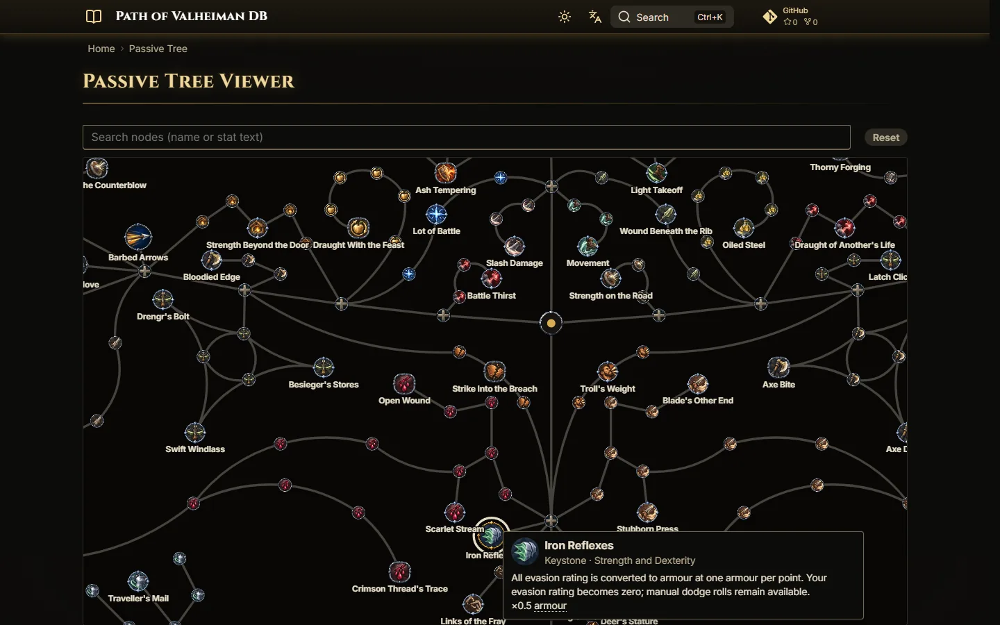
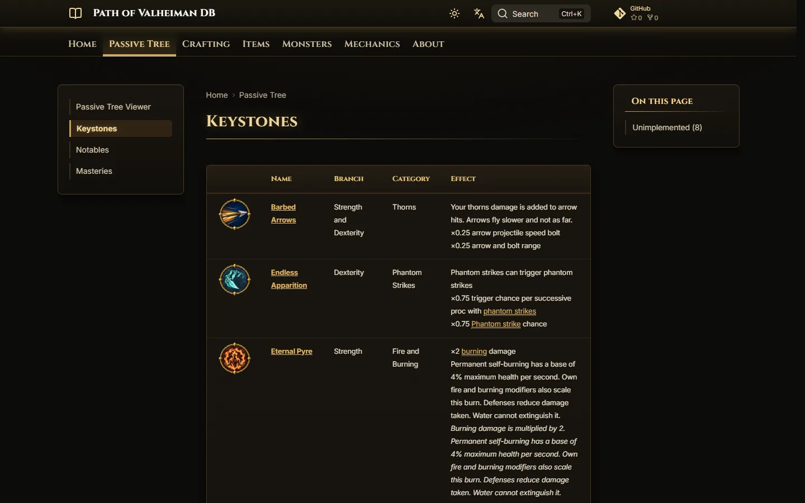
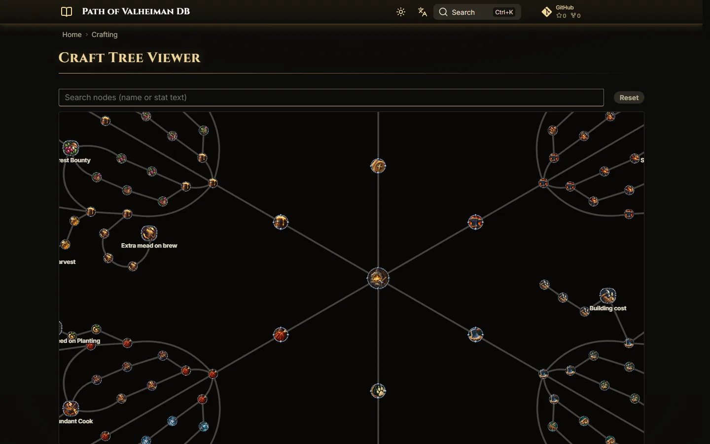
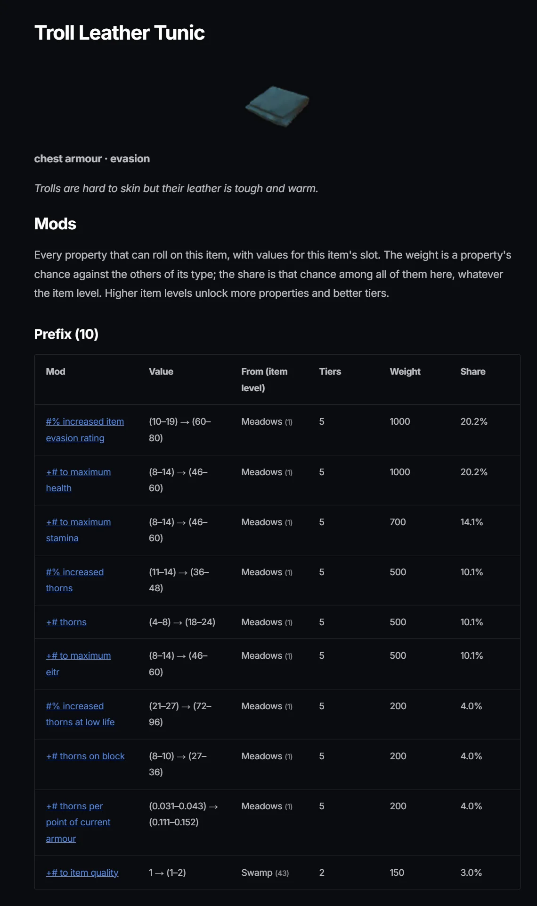
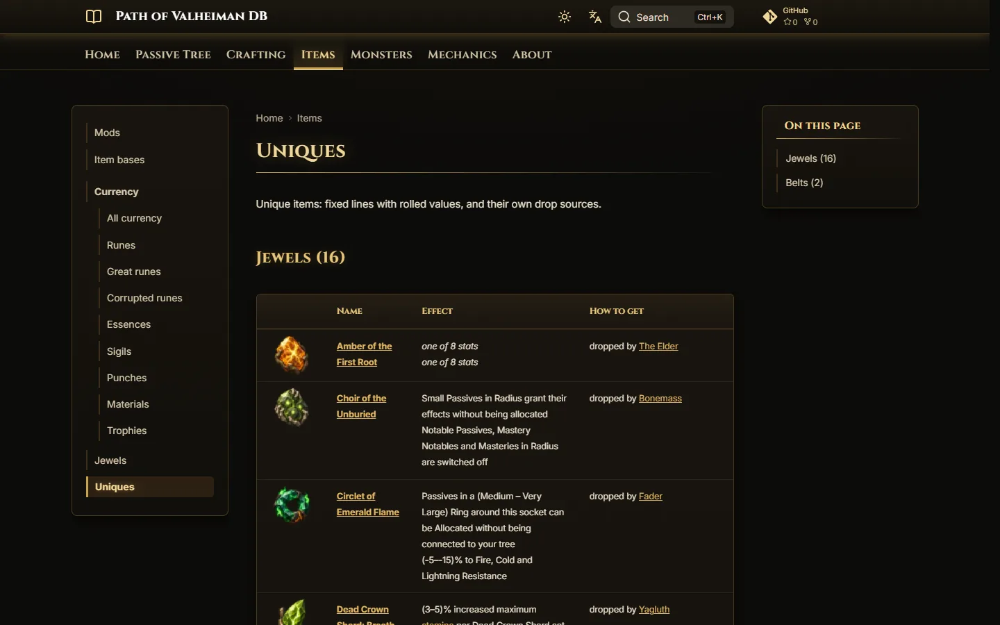
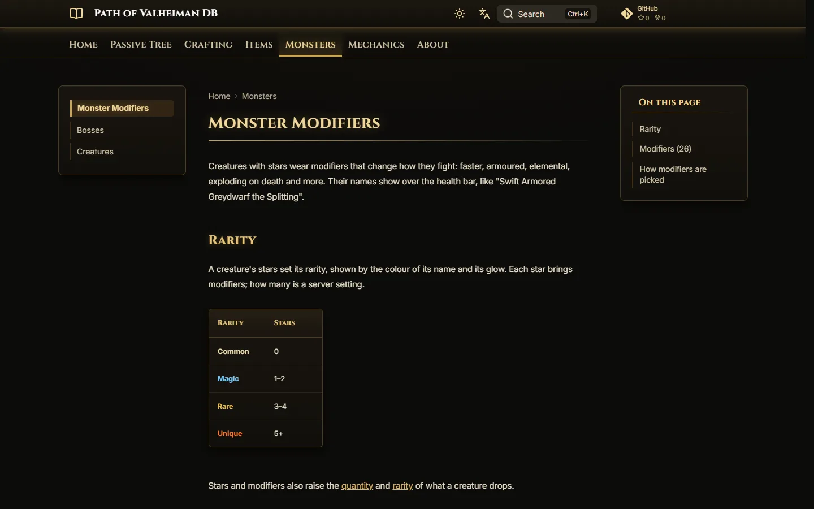
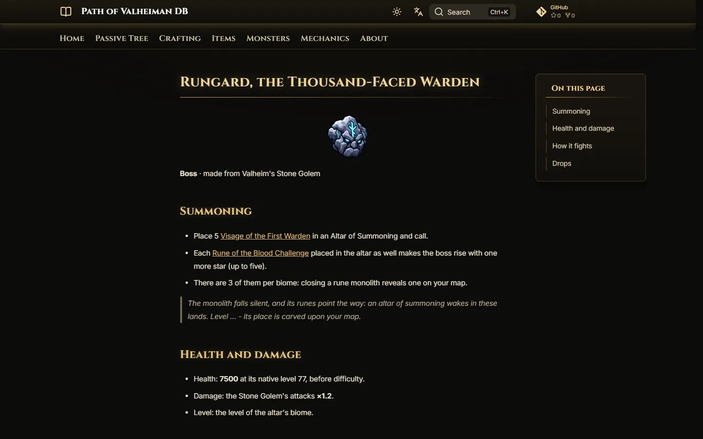
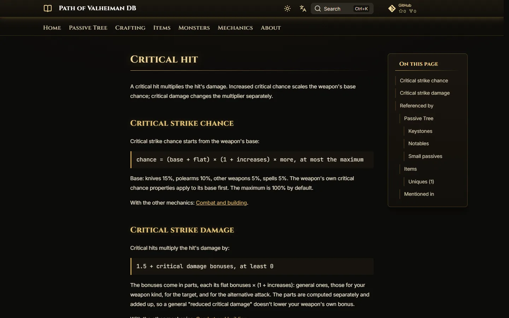
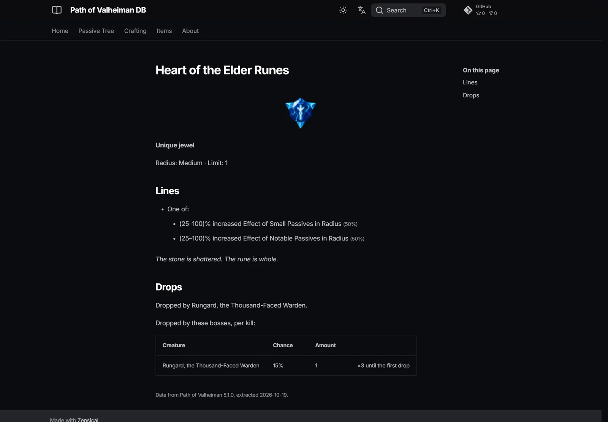

# pov-wiki

**Live site: https://povdb.wiki/**

A datamined wiki for **[Path of Valheiman](https://valheim.hexium.gg/mods/treextr/PathOfValheiman)**,
the Path of Exile–style passive tree, crafting and loot overhaul for Valheim by **treextr**.
It works like [poedb.tw](https://poedb.tw) for Path of Exile: nobody types pages in by hand.
Every page is generated from the mod's own files, so the wiki matches each release exactly.

> Unofficial fan project. All game data and text belong to the mod author. This repo never
> contains or redistributes the mod itself (see [Licence](#licence)).

## Screenshots



| | |
|---|---|
|  |  |
| **Keystones, notables and masteries**, with the game's icons and wording | **Crafting**: the craft tree, professions, quests, masteries and buildings |
|  |  |
| **Items**: every base with stats, recipe and its full mod pool | **Uniques, jewels and currency**, with their lines and where they drop |
|  |  |
| **Monsters**: modifiers, rarity, and the mod's creatures | **Bosses**: how to summon them, how they fight and what they drop |
|  |  |
| **Mechanics**: the game's formulas, checked against the code with every patch | **Every item** has its own page: lines, radius, drop sources and links |

## How it works

```
fetch    hexium ──▶ .cache/downloads/*.zip
extract  zip ──▶ .cache/extracted/<ver>/   tree.json, crafttree.json, loot.catalog.json, loc/*.txt
render   mod's own code ──▶ .cache/extracted/<ver>/rendered/<language>.json   node titles + stat lines, as in game
build    ──▶ build/<lang>/ (markdown + config) ──zensical──▶ site/<lang>/
deploy   site/ ──▶ gh-pages branch ──▶ GitHub Pages
```

- **extract**: `PathOfValheiman.dll` embeds its game data as .NET resources (passive tree,
  craft tree, loot/affix catalog, every translation), read with
  [dnfile](https://github.com/malwarefrank/dnfile).
- **render**: stat lines are composed by ~2,000 lines of game code (conditions, subjects,
  conversions…). Instead of re-implementing that, `povwiki render` loads the mod into .NET 8 via
  [pythonnet](https://pythonnet.github.io/) and calls its own tooltip code, in every language.
  The wiki shows exactly what the game shows, and formatter changes in a patch come through by
  themselves.

Details in [notes/datamining.md](notes/datamining.md).

## Quick start

Needs:

- [uv](https://docs.astral.sh/uv/) (installs Python and the dependencies);
- the [.NET 8 runtime](https://dotnet.microsoft.com/download/dotnet/8.0) (for `render`);
- **Valheim** installed through Steam (`render` uses its Unity DLLs; it is found automatically,
  or set `VALHEIM_MANAGED` to `.../Valheim/valheim_Data/Managed`). BepInEx, Jotunn and MonoMod
  are downloaded automatically into `.cache/deps/`.

```sh
uv sync
uv run povwiki fetch            # download the latest release from hexium, extract, render
uv run povwiki build            # all enabled languages -> site/
uv run povwiki serve --lang en  # fastest dev loop: generate pages (~3 s) + live preview at http://localhost:8000
uv run povwiki deploy           # build + publish to https://povdb.wiki/
```

`povwiki extract <zip>` works on any local mod zip instead, e.g. an older version.

Builds print how long each step takes. A full build is about 15 s: most of it is Zensical
rendering ~1,800 pages. Node icons are generated once per mod version and settings, and cached
under `.cache/extracted/<ver>/web/`.

Everything runs locally; `deploy` force-pushes the built site to the `gh-pages` branch, which
GitHub Pages serves directly (no Actions). Automated rebuilds on new mod releases would need
Valheim's DLLs in CI (e.g. the free dedicated server via SteamCMD) and come later.

## Layout

| Path | What |
|---|---|
| `src/povwiki/` | Pipeline: `fetch.py`, `extract.py` (DLL → JSON), `render.py` + `harness/` (game text via the mod's code), `data.py`, `i18n.py`, `markup.py` (game rich text → Markdown), `pages.py` (page generators, nav), `generate.py` (build, config), `deploy.py` |
| `content/<lang>/` | Hand-written pages (home, about) |
| `i18n/languages.toml` | Wiki languages and their mod localization file |
| `i18n/ui/<lang>.toml` | The wiki's own strings (headings, table columns, nav) |
| `zensical.toml` | Base site config; copied per language at build time |
| `notes/` | Developer notes on the data formats |
| `.cache/`, `build/`, `site/` | Mod files, extracted data, build output (all git-ignored) |

## Translations

The site is English-only for now. Translation support is built in:

- **Game text** (node names, stat lines, wiki entries) comes from the mod itself: rendered by
  its own code in each language, or looked up by key in its localization files. A new language
  gets every game string for free (`render` already produces all 8 the mod ships).
- **Wiki text** lives in `i18n/ui/<lang>.toml`. Missing keys fall back to English.
- **Hand-written pages** go in `content/<lang>/`. Missing pages fall back to English.
- Each language builds to its own path (`/en/`, `/fr/`, …), and the theme's language switcher
  appears once more than one language is enabled.

To add a language, set `enabled = true` in `i18n/languages.toml` and add `i18n/ui/<code>.toml`.

## Docs stack

[Zensical](https://zensical.org), the successor to Material for MkDocs from the same team
(Material is now in maintenance mode). Zensical builds static HTML, gives full-text search out of
the box, and uses the same Markdown extensions. Zensical is still 0.0.x, so its version is pinned in
`pyproject.toml`.

## Roadmap

- [x] Repo, pipeline skeleton, DLL data extraction, i18n design
- [x] Stat lines exactly as in game (rendered by the mod's own code)
- [x] Passive tree: keystones, notables, masteries, a page per keystone/notable; keyword pages from the in-game wiki, with backlinks
- [x] Unfinished game content shown with an Unimplemented / Unfinished text badge
- [x] Interactive passive tree viewer (game layout, colours and icons; search, deep links)
- [x] Node and mastery icons, resolved through the game's own icon chain (switch: `[tool.povwiki] icons` in `pyproject.toml`)
- [ ] Jewels and sockets, small passive overview
- [x] Craft tree: viewer, professions, notables, masteries, node and option pages (own Crafting section)
- [x] Craft professions: areas and stages, notables, quest families with targets/rewards per areas revealed
- [x] Items: mods (affixes) with tiers, item levels, weights, roll rules and values by slot
- [ ] Items: Valheim bases, item classes and mod pools; uniques; currency; loot tables (see notes/items-plan.md)
- [ ] Patch diffs between versions
- [x] `povwiki fetch` (latest release from hexium) and local `povwiki deploy`
- [ ] Automated rebuilds on new mod releases (needs Valheim DLLs in CI)

## Licence

Code in this repo: TBD. The mod's [licence](https://valheim.hexium.gg/mods/treextr/PathOfValheiman)
allows reading it and reusing parts with credit. It forbids re-publishing the mod. That is why
mod archives, the DLL and extracted data are git-ignored and fetched at build time. The node icons
on the site are the mod author's art, credited on the About page. If the author objects, set
`icons = false` under `[tool.povwiki]` in `pyproject.toml` and redeploy.
